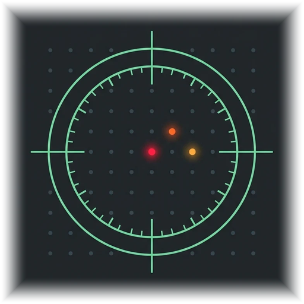
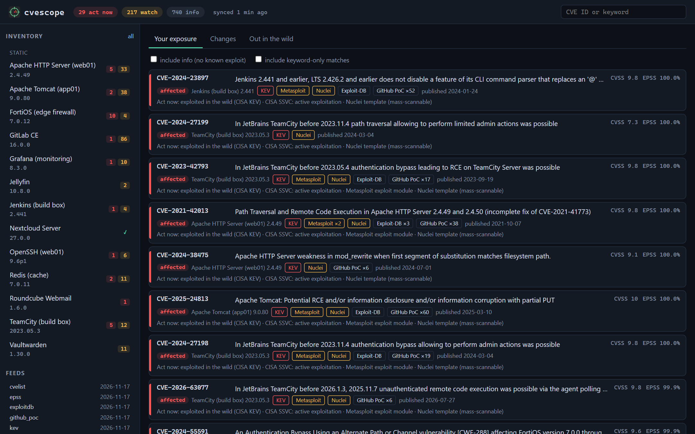
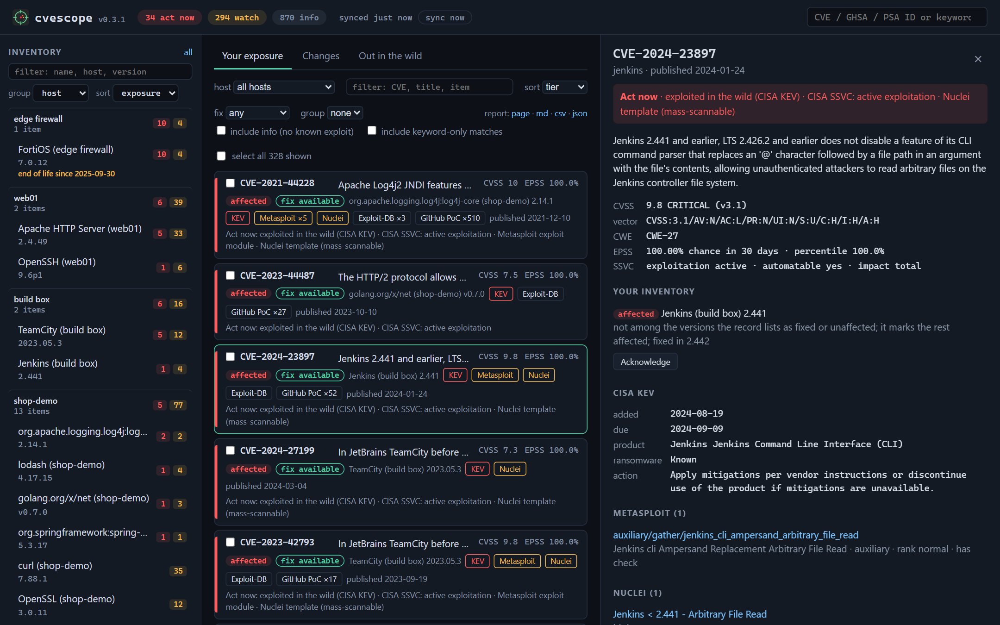
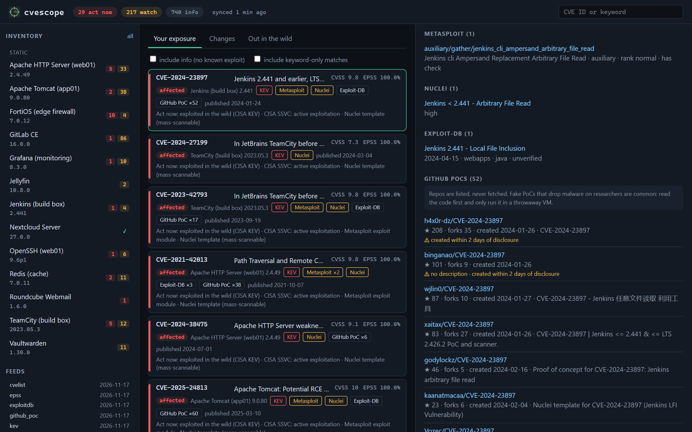
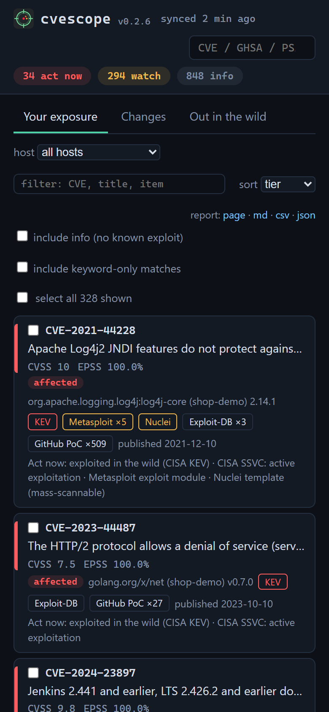
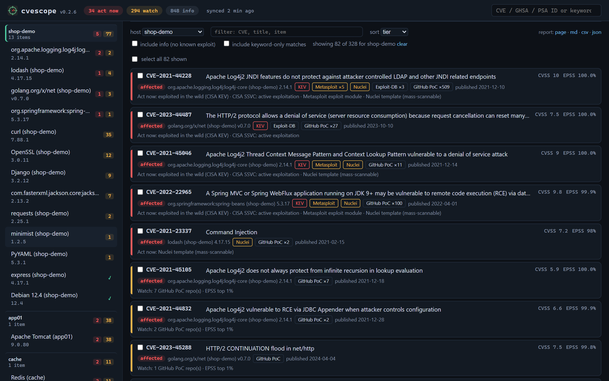
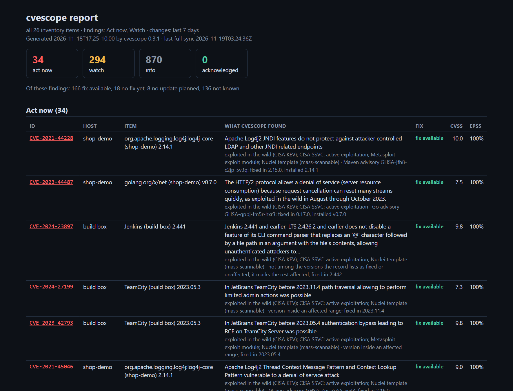

<p align="center"></p>

# cvescope

<p align="center">
  <a href="https://github.com/magikh0e/cvescope/actions/workflows/test.yml"></a>
  <a href="https://github.com/magikh0e/cvescope/releases/latest"></a>
  <a href="LICENSE"></a>
  
</p>

The CVEs that hit the gear you actually run, ranked by whether anyone is exploiting them.

There are 40,000+ new CVEs a year. Almost none of them matter to you. cvescope asks your
firewall, hypervisor, DNS boxes and apps for their versions, matches them against the full
CVE List, and sorts what's left by real-world evidence: CISA KEV, Metasploit and Nuclei
coverage, Exploit-DB, public PoCs, and EPSS. Then it tells you when that evidence changes,
like when a CVE you've been ignoring suddenly gets a Metasploit module.

It runs on your own machine. Python 3.11+, standard library only, no account, no API keys.

The write-up on my site covers why I built it and how it ranks things:
**[magikh0e.pl/pubCode/cvescope.html](https://magikh0e.pl/pubCode/cvescope.html)**



<sub>Screenshots use the made-up network in [`examples/demo.toml`](https://github.com/magikh0e/cvescope/blob/main/examples/demo.toml).</sub>

## What you get

- **Your exposure:** every matched CVE, split into three tiers:
  - **Act now:** exploited in the wild (KEV, CISA SSVC "active"), a Metasploit exploit
    module, or a Nuclei template for a CVSS 7+ bug.
  - **Watch:** public exploit code (Exploit-DB, GitHub PoC, your own archive), a Metasploit
    auxiliary module, SSVC "poc", or EPSS in the top 10%.
  - **Info:** it matches, but nothing suggests anyone is using it.
- **Changes:** a CVE that touches your inventory got added to KEV, picked up an exploit, had
  its EPSS jump, or stopped applying after you upgraded.
- **Out in the wild:** recent KEV additions, newly weaponized CVEs, and the highest-EPSS new
  CVEs, whether you run the product or not.
- **Alerts** via ntfy, Home Assistant, or any webhook, for changes at or above a tier you pick.
- **Acknowledgements** for what you've already handled. They hide a CVE until the evidence
  gets worse or an end date you set passes.
- **A page you can slice:** the inventory grouped by host, filters, and the match list grouped
  by host or item with foldable groups, so even a few hundred "info" findings stay readable.
  A **sync now** button runs a full sync from the page when you don't want to wait for the
  schedule.
- **What you can fix today:** each finding says whether the vendor has shipped a fix (fix
  available), hasn't yet, or plans none. Filter or group by it to find the updates that clear
  findings, and skip the ones only the vendor can move.

## Quick start

```bash
pip install cvescope             # Python 3.11+, no dependencies
cvescope init                    # writes a starter config to your user config dir
# edit it: add [[inventory]] blocks for your gear (see cvescope/config.example.toml)
cvescope sync                    # first run downloads ~750 MB (CVE List + PoC index), ~800 MB on disk
cvescope report                  # act-now and watch tiers in the terminal
cvescope serve                   # the page at http://127.0.0.1:8096/
```

The first sync of each feed is treated as history: it loads quietly and raises no alerts.
After that, run `cvescope sync` on a schedule (below) and only real changes come through.

To run the latest code instead, install from a checkout: `git clone
https://github.com/magikh0e/cvescope && cd cvescope && pip install .` (or skip the install and
use `python -m cvescope` there).

Want to see it work before wiring up your own gear? The demo config, in a checkout, describes a
small, badly patched network (and a container SBOM) and keeps its data in a separate folder:

```bash
cvescope --config examples/demo.toml sync
cvescope --config examples/demo.toml serve       # http://127.0.0.1:8098/
```

| CVE detail | Exploits and PoCs | On a phone |
|---|---|---|
|  |  |  |

## Inventory

Each `[[inventory]]` block in the config is one collector:

| type | what it reads | needs |
|---|---|---|
| `static` | a product and version you type in | nothing |
| `command` | a version pulled from any command's output (works over `ssh`) | the command |
| `dpkg` | packages on a Debian/Ubuntu host, checked against the distro's own tracker | `dpkg-query` over ssh |
| `http_json` | a version field from any JSON endpoint | URL + dotted path |
| `nmap_xml` | every open service nmap identified in a `-sV` scan you ran | the XML file(s) |
| `sbom` | every component of a CycloneDX or SPDX SBOM (syft, trivy, cdxgen, your build) | the SBOM file(s) |
| `docker` | the app in each running Docker/Podman container, from its image tag or version label | `docker ps` (local or ssh) |
| `osquery` | installed programs, apps and packages, live through `osqueryi` (local or ssh) or from saved results | osquery, or the JSON file(s) |
| `wpscan` | WordPress core, theme and plugin versions from a WPScan report | the JSON file(s) |
| `whatweb` | web stack versions (server, PHP, CMS, JS libraries) from WhatWeb | the JSON file(s) |
| `proxmox` | PVE version, every VM/container (OS via the guest agent), optionally QEMU, LXC, kernel; package builds and the running kernel checked against Proxmox's own advisories | API token, PVEAuditor role |
| `opnsense` | OPNsense, its FreeBSD base and OpenSSL, plus OpenSSH, Unbound, dnsmasq, Suricata and other packages (or all of them), checked against FreeBSD's VuXML | API key/secret |
| `unifi` | UniFi Network version and every adopted device's firmware | Control Plane API key |
| `pihole` | Pi-hole v6 core, FTL and web versions | app password |
| `homeassistant` | HA Core (checked against Home Assistant's own advisories), plus OS, Supervisor, add-ons and ESPHome devices from its update entities | long-lived token |

Secrets never go in the config file. Point at them with `token_file` / `token_env`
(or `password_file`, `apikey_file`, `key_file` + `secret_file`).

Self-signed appliances: get the certificate fingerprint with `cvescope pin 192.168.1.1:443`,
check it against the device's own UI, and set `pin_sha256`. The pin is checked before any
credential is sent. Without a pin or `verify_tls = true`, cvescope refuses to connect.

If a collector fails (device offline, token expired), its last known versions are kept and
the page marks it, so one outage doesn't make your matches vanish.

### Debian and Ubuntu packages

Distros backport fixes, so `openssh 1:9.6p1-3ubuntu13.5` can be patched against a CVE whose
upstream range says 9.6p1 is affected. For Debian and Ubuntu hosts cvescope asks the distro
instead: the Debian security tracker's own JSON and Canonical's per-release OVAL
data list, per source package, which CVEs were fixed and in which build. Give the `dpkg`
collector the host's os-release along with the package list and every package gets a real
answer:

```toml
[[inventory]]
type = "dpkg"
name = "web1"
command = ["ssh", "web1", "cat /etc/os-release; echo ---; dpkg-query -W -f='${db:Status-Abbrev} ${Package} ${Version} ${source:Package}\\n'"]
# packages = "all"   # every source package, not just the ~60 cvescope has names for
```

Only the releases your inventory runs are kept (Debian ~15 MB, then only when it changes;
Ubuntu ~2 MB per release). A CVE the tracker doesn't list for the package counts as not
affecting it, unless it's under two weeks old and may not have been triaged yet. One the
tracker marks not-affected for your release (the vulnerable code never shipped in it) is
not_affected even if the upstream range covers your version.

Ubuntu's OVAL feed leaves out CVEs Canonical hasn't triaged yet and ones it marks
not-affected, so a CVE under two weeks old stays "check" on an Ubuntu host. With
`sources.ubuntu_lookup = true`, cvescope asks Ubuntu's CVE tracker about exactly those (fresh,
"check", no OVAL answer) and uses what it says: not-affected settles it at once, "needs triage"
reads as "hasn't decided yet (not triaged)", and released or needed work as they do from OVAL.
Answers are cached (decided ones for three days, untriaged ones twelve hours) and OVAL wins
whenever it lists the CVE. It's off by default because each lookup tells Canonical which CVE ID
you're checking; the OVAL download itself sends nothing.

"Affected" with no update in `apt` usually means Debian hasn't released a fix. The reason says
why when the tracker does: "no security update planned: Minor issue" (it may arrive in a point
release, or never), "postponed by Debian", or "a fix is queued for the next point release". The same
applies to `osquery` `deb_packages` results and to Debian/Ubuntu VMs found through Proxmox.

Each finding carries what that means for you, as a **fix** state the page can filter and group
by, and every report lists:

| Fix | Means | Read from |
|---|---|---|
| **available** | The vendor shipped a fixed build: update (or reboot, for a Proxmox kernel already installed) | Debian/Ubuntu fix newer than installed, VuXML or OSV "fixed in", every Proxmox PSA, and for apps nobody backports to, the release the CVE record names as fixed ("< 3.5.10") |
| **not yet** | No fix released, or the vendor hasn't decided | Debian/Ubuntu open, postponed, queued for a point release, not triaged |
| **not planned** | The vendor plans no update for this release | "no security update planned", "won't fix it", out of security support |
| **not known** | No vendor patch data | Upstream ranges that name no fix, backported distro packages no tracker answered, keyword matches |

When a fix ships for something you run (a finding goes from **not yet** or **not planned** to
**available**), that's a change of its own: "fix available (glibc (web1)): Debian 13 fix
2.41-12+deb13u1 is newer than 2.41-12". It shows in **Changes** and goes out as an alert.

### FreeBSD and OPNsense packages

OPNsense builds its packages from FreeBSD ports, and FreeBSD keeps its own vulnerability
database, VuXML (the one `pkg audit` reads). The `opnsense` collector records each package's
exact build (`openssl35 3.5.9`, `sudo 1.9.17p2_4`, `dnsmasq 2.93,1`) and the base release
(`15.1-RELEASE-p6`). Both are compared against VuXML using pkg's own version rules:

- VuXML lists the CVE for that package and your build is inside its range: **affected**, with
  the fixed build ("fixed in 3.5.10, installed 3.5.9"). The OPNsense update that ships it is
  the fix.
- VuXML lists it and your build is outside the range: **not_affected** ("fixed in 2.86_4,1").
  Base-system advisories work the same way against the patch level, so an old FreeBSD SA for
  14.1 no longer shows as "check" on 15.1-RELEASE-p6.
- VuXML doesn't list it: the upstream answer stands. VuXML doesn't cover every CVE a port is
  hit by, so silence there doesn't mean safe.

`packages = "all"` on the `opnsense` collector adds every installed package, which makes the
check equivalent to `pkg audit` on the firewall. FreeBSD VMs found through Proxmox get the
base-release check too. VuXML is ~1.4 MB and only downloaded when you have one of these.

### Home Assistant

Home Assistant Core is published on PyPI as `homeassistant`, and Home Assistant's GitHub security
advisories reach [OSV.dev](https://osv.dev/) listing every release each one affects. cvescope asks
OSV.dev for them on each sync (one small query) and lets them decide the CVEs they name: affected
when your release is listed ("fixed in 2026.6.0, installed 2026.5.4; update available: 2026.6.1"),
not_affected otherwise. That also settles old "description mentions Home Assistant" matches an
advisory covers.

The OS, Supervisor, add-on and ESPHome device versions come from Home Assistant's update
entities, which any long-lived token can read (the Supervisor API needs an admin token). Those
match against the CVE List as usual; Home Assistant OS has no advisory feed of its own.

### Proxmox VE

Proxmox publishes its security advisories (PSAs) as posts in one
[forum thread](https://forum.proxmox.com/threads/proxmox-virtual-environment-security-advisories.149331/),
each naming the fixed package builds. cvescope reads the whole thread once and then only its
last page on each sync. The `proxmox` collector always reads the host's Proxmox package builds
and the running kernel (the API's package-version list, which the PVEAuditor role can see), and
every CVE a PSA names gets an answer for that host:

- the installed build is older than the fix for its release line: **affected** ("fixed in
  pve-manager 8.2.7, installed 8.2.5"). Fixes tagged for another release line are set aside,
  since Proxmox sometimes changes a package's version scheme between releases.
- otherwise **not_affected**. A host on a newer release than every line the PSA fixes isn't
  affected.
- kernels compare per series against the **running** kernel, so a fixed kernel that's installed
  but not booted yet still counts as affected, with "reboot to run it".

Most PSAs name no CVE (Proxmox finds many issues itself); those show up under their PSA ID (see
below). Debian's own packages on a Proxmox host (OpenSSH, OpenSSL, glibc ...) aren't in
the API's list; add a `dpkg` collector over ssh for the host to check them against the Debian
tracker.

### Findings without a CVE ID

Some real issues never get a CVE: most Proxmox advisories (PSA-...), many GitHub advisories for
npm, PyPI and Maven packages (GHSA-...), and other OSV.dev entries (PYSEC-, GO-, RUSTSEC-, and
MAL- for malicious package releases). cvescope keeps those under their own ID and treats them
like CVEs: they're matched, ranked, acknowledged and alerted on the same way, the page links each
one to its source (the GitHub advisory, the Proxmox forum post, osv.dev), and the search box
finds them by ID. They carry no KEV, Metasploit or EPSS data, so they rank as info. An advisory
that also has a CVE is always shown under the CVE.

### SBOMs

An SBOM (software bill of materials) lists everything inside an app, container image or VM,
down to each library and its exact version. Generate one with whatever you already use (syft,
trivy, cdxgen, your build) and point an `sbom` collector at it:

```bash
syft my-app:latest -o cyclonedx-json > ~/sboms/my-app.cdx.json
```

```toml
[[inventory]]
type = "sbom"
path = "~/sboms/*.json"     # a file, a folder (every .json/.xml/.spdx in it) or a glob
# name = "web1"             # file everything under one host (default: each SBOM's own name)
```

CycloneDX (JSON or XML) and SPDX (JSON or tag-value) are read. Every component with a name and
a version becomes an item, and each one is checked against the best data there is for it:

- **Language packages** (PyPI, npm, Maven, Go, crates.io, RubyGems, NuGet, Packagist, Hex, Pub)
  against their ecosystem's advisories on OSV.dev, which name the fixed release per release
  line: "Maven advisory GHSA-jfh8-c2jp-5v3q: fixed in 2.15.0, installed 2.14.1". All of an
  SBOM's packages go in one batch query, and only new or changed advisories are downloaded.
- **Debian and Ubuntu packages** (purl `pkg:deb/...` with a distro, or the SBOM's
  operating-system component) against the distro's own tracker, as for the `dpkg` collector.
- **Anything with a CPE** against the CVE List under that vendor and product.

The page groups the components under the SBOM's name, so filtering by host shows one image or
app at a time. The demo config includes a sample SBOM (`examples/demo-sbom.cdx.json`).



### Containers, endpoints and websites

- **`docker`** runs `docker ps` (or `podman ps`) locally or through `command_prefix = ["ssh", "host"]`
  and names the app in each container from its image. A floating tag like `latest` is resolved
  through the image's version label; if there isn't one, the container is listed but not matched.
  This covers the app, not the OS packages inside the image (use an SBOM tool for those).
- **`osquery`** works two ways. Without a `path`, cvescope runs `osqueryi` itself, on this
  machine or through `command_prefix = ["ssh", "host"]`, and picks queries for the OS it finds:
  `programs` plus the exact build and update revision on Windows, `apps` and Homebrew on macOS,
  `deb_packages` or `rpm_packages` plus `kernel_info` on Linux. You can replace them with your own
  `queries = [...]`. With a `path`, it reads saved results instead: `osqueryi --json` output,
  osqueryd result logs, or the JSON written by
  [`examples/windows-inventory.ps1`](https://github.com/magikh0e/cvescope/blob/main/examples/windows-inventory.ps1) on machines without osquery.
  Either way, the exact Windows build means Microsoft's CVE ranges match precisely, and Debian or
  Ubuntu packages go through the distro tracker. About 50 common programs are mapped by name
  (browsers, archivers, remote-access and VPN clients, dev tools); `programs = "all"` adds the rest.
  osquery only reads the host's own state, so this doesn't change cvescope's never-scans rule.

  ```toml
  [[inventory]]
  type = "osquery"                 # this machine, live
  [[inventory]]
  type = "osquery"
  name = "nas"
  command_prefix = ["ssh", "nas"]  # another host, live over ssh
  ```
- **`wpscan`** and **`whatweb`** read reports from those scanners. Run them only against sites
  you're allowed to test.

### Proxmox guests

The `proxmox` collector lists every VM and container (`guests = false` turns it off). VMs with
the QEMU guest agent report their OS and kernel, so a forgotten Debian VM shows up with its
version and goes through the Debian tracker. Containers only report their OS type; they're
listed with a hint to add a `dpkg` collector for them.

### Finding gear you forgot about

cvescope never scans anything itself. It only knows what you list. To cover the NAS, camera
or old VM nobody remembers, run an nmap version scan yourself, on networks you're allowed to
scan, and point an `nmap_xml` collector at the output:

```bash
nmap -sV -oX ~/scans/lan.xml 192.168.1.0/24
```

```toml
[[inventory]]
type = "nmap_xml"
path = "~/scans/*.xml"        # a file, a glob, or a list
hosts = ["192.168.1.0/24"]    # optional: only these CIDRs, IPs or hostnames
max_age_days = 30             # skip stale scans
```

Every open service nmap identified becomes an item, named like `OpenSSH (nas.lan:22)`, using
nmap's CPE where it has one. The same product on several ports of a host becomes one item. A
version string with a distro build in it ("9.6p1 Ubuntu 3ubuntu13.5") is treated like a distro
package, so in-range hits show as "check". Services nmap named but couldn't version are left
out unless you set `unversioned = true`. When several files cover the same host, the newest
scan wins. Re-run the scan on your own schedule (cron, Task Scheduler) and the next
`cvescope sync` picks it up.

Your IDS will see the scan. If you run one, plan for the alerts.

## How matching works

The CVE List record for each CVE says which vendor/product/version ranges are affected.
cvescope matches your items against those names (and the CPEs CISA's Vulnrichment adds),
then checks your version against the ranges. Each match gets a status:

- **affected:** your version is inside an affected range.
- **check:** the product matches but the record can't settle your version, or it's a distro
  package (Debian, Proxmox kernel, FreeBSD base) whose fixes may be backported. Look it up
  in the vendor's or distro's tracker.
- **not_affected:** your version is outside every affected range. Kept for the record and
  counted as "ruled out" on the page.
- **keyword:** an old CVE whose record names no product mentions your item in its text. Low
  confidence, hidden unless you ask for it.

Version data in CVE records is messy, so cvescope copes with a few common patterns: free text
("before 2.4.60", "1.0 - 1.5", "Fixed in OpenSSL 1.1.1g (Affected 1.1.1d-1.1.1f)"), FreeBSD
patch levels, CISA's habit of splitting one product into many single-range entries, and CNAs
that set `defaultStatus: affected` next to a single "below the fix" range. When a record has
no version data at all, it reads the description: if the only versions named next to the
product are older than yours ("OpenSSL 1.0.1 before 1.0.1g"), the CVE is ruled out. Open-ended
wording ("and later", "since") is left as **check**.

Match quality depends mostly on aliases: how CVE records spell your product. The built-ins
live in `cvescope/collectors/packages.py`; add your own per item with `aliases = [...]`.

## Data sources

| feed | what it adds | size / cadence |
|---|---|---|
| [CVE List](https://github.com/CVEProject/cvelistV5) | every CVE record, incl. CISA Vulnrichment (SSVC, CPEs, CVSS) | ~660 MB once, then hourly/daily delta zips |
| [CISA KEV](https://www.cisa.gov/known-exploited-vulnerabilities-catalog) | confirmed exploitation in the wild | ~2 MB, conditional GET |
| [FIRST EPSS](https://www.first.org/epss/) | daily 30-day exploitation probability | ~3 MB/day |
| [Metasploit](https://github.com/rapid7/metasploit-framework) module metadata | weaponized exploits and scanners | ~11 MB, conditional GET |
| [Nuclei templates](https://github.com/projectdiscovery/nuclei-templates) `cves.json` | mass-scannable checks | ~2 MB |
| [Exploit-DB](https://gitlab.com/exploit-database/exploitdb) index | published exploit code | ~10 MB |
| [PoC-in-GitHub](https://github.com/nomi-sec/PoC-in-GitHub) | GitHub repos claiming a PoC | ~85 MB shallow clone, needs git |
| your own folders | any file that mentions a CVE ID | local scan, only new files after the first run |
| [Debian security tracker](https://security-tracker.debian.org/) JSON | fixed package version per Debian release | ~15 MB, only if you run Debian |
| [Ubuntu OVAL](https://security-metadata.canonical.com/oval/) | fixed package version per Ubuntu release | ~2 MB per release you run |
| [Ubuntu CVE tracker](https://ubuntu.com/security/cves) (optional) | Ubuntu's answer for fresh CVEs its OVAL feed doesn't list yet | one small request per fresh CVE, cached; off unless `sources.ubuntu_lookup = true` |
| [FreeBSD VuXML](https://vuxml.freebsd.org/) | affected package builds and base-system patch levels, as `pkg audit` uses them | ~1.4 MB, only if you run OPNsense or FreeBSD |
| [OSV.dev](https://osv.dev/) | advisories for Home Assistant Core and every SBOM language package (PyPI, npm, Maven, Go, ...) with the affected releases | one batch query per sync plus new or changed advisories, only if you have those |
| [Proxmox VE advisories](https://forum.proxmox.com/threads/proxmox-virtual-environment-security-advisories.149331/) | fixed package builds per Proxmox security advisory (PSA) | the whole forum thread once (~6 pages), then its last page, only if you run Proxmox VE |

### Optional: NVD lookup

The NVD isn't a feed here. Its analysis backlog means it often lags the CVE List itself. It does
help with one thing: some CVE records carry no usable version data (old MITRE-era records,
vendors that only list their own rebuilds), while NVD's analysts add CPE ranges with exact fixed
versions. Turn it on and cvescope asks NVD about those records, but only for matches that are
still **check** and showing up in act now or watch:

```toml
[nvd]
enabled = true
# api_key_env = "NVD_API_KEY"   # optional (or api_key_file); raises the rate limit tenfold
max_per_run = 40
```

It's off by default because each lookup tells NIST a CVE ID you care about. Without a key, NVD
allows 5 requests per 30 seconds, so a run with 40 lookups takes about 4 minutes. Answers are
cached: one with no ranges yet is asked again after 7 days, the rest after 60. If a key gets
rejected, that run falls back to keyless.

## A word on GitHub PoCs

Fake proof-of-concept repos that drop malware on the people who run them are a long-running
trick. cvescope never clones or fetches PoC repos. It lists their metadata and flags the usual
tells (no stars or forks, no description, a pitch to download a release or make contact,
created within two days of disclosure). Read the code first, and only run it in a throwaway VM.

## Alerts

```toml
[notify]
min_tier = "act"
fixes_min_tier = "info"   # optional: tell me about every fix I can install, whatever its tier

[[notify.ntfy]]
url = "https://ntfy.sh/pick-a-long-random-topic"

[[notify.homeassistant]]
url = "http://homeassistant.local:8123"
token_env = "HASS_TOKEN"
service = "notify.mobile_app_your_phone"
```

`min_tier` decides which changes are worth a message. "A fix is out now" changes use
`fixes_min_tier` instead when you set it, so you can hear about every update that clears a
finding without getting every info-tier change. Left out, it follows `min_tier`.

`cvescope notify --test` sends one test message to every channel. `cvescope sync --dry-run`
prints what it would send without marking anything as sent.

## Acknowledging what you've handled

Some act-now entries are things you've already dealt with: a fix Microsoft made opt-in that
you've turned on, a service you've firewalled off, an upgrade that's booked. Acknowledge them
and they leave act now, watch, the counts and the alerts:

```
cvescope ack CVE-2013-3900 --item pc1 -m "applied the opt-in fix"
cvescope ack CVE-2024-23897 -m "CLI disabled, upgrading Saturday" --days 7
cvescope acks              # what's acknowledged, and whether it still holds
cvescope unack CVE-2024-23897
```

Or open the CVE on the page and use **Acknowledge** under "Your inventory". Without `--item`,
`ack` covers every item the CVE shows up on, and it takes several CVE IDs at once.

To acknowledge many at once on the page, tick the boxes next to the matches (or "select all
shown" after narrowing the list with the host picker or the text filter), add one note and an
optional end date, and press **Acknowledge**. "Remove acknowledgement" does the reverse for the
ticked ones that are acknowledged, and the confirmation has an **undo**. Only the rows on
screen can be ticked, so a filter change never acknowledges something you can't see.

An acknowledgement comes back by itself when its end date passes (the end date is optional), or
when the evidence gets worse than it was when you acknowledged it: a higher tier, a new kind of
exploitation evidence (added to KEV, a first Metasploit module, SSVC raised), or a **check**
that turns out **affected**. The page and `cvescope report` then show it again with the reason.
More of the same evidence (another GitHub PoC, EPSS moving within its tier) and a new version
of the item, such as a monthly Windows build, don't bring it back. Each acknowledgement and
removal is kept in the CVE's history. "Show acknowledged" on the page lists the hidden ones.

## Reports

A report puts it all in one place for someone else, or for later: the counts, the findings
that need doing (with why they rank where they do, what fixes them, and whether that fix is
out yet), every host, what
changed in the last days, what's acknowledged with its note and end date, and the blind spots
(items without a version, failed collectors, feeds with errors).

```
cvescope report --format html --out ~/reports/cvescope-%Y-%m-%d.html
cvescope report --format csv --tier info --host web1
cvescope report --format md --days 30 > status.md
```

- `html` is one self-contained file without scripts; open it and print to PDF.
- `md` pastes into a ticket, a wiki or a chat.
- `csv` has one row per finding (acknowledged ones flagged) for a spreadsheet. New columns go
  at the end (`fix` is the last), so a sheet built on an older report keeps working.
- `json` is everything, for other tools.

`--tier` sets which findings are listed (the counts always cover all of them), `--host` keeps
one host, `--days` sets how far back the changes go, and `--out` accepts date codes, so a
scheduled task can keep one report per week. On the page, the **report** links next to the
filters give the same thing for what you're looking at: the host you picked, and info only
when it's included. Feed text is escaped for each format, including spreadsheet formulas in
CSV.



## Scheduling

`--log FILE` appends everything a run prints to a file (rotated at 5 MB), which is what you want
when nothing is watching the console.

Linux/macOS (cron, every 3 hours):

```
0 */3 * * * cvescope --log ~/.local/share/cvescope/sync.log sync
```

Windows (Task Scheduler, every 3 hours, no console window, catches up after sleep). In PowerShell,
after `pip install cvescope`:

```powershell
$py = (Get-Command pythonw).Source
$a  = New-ScheduledTaskAction -Execute $py -Argument "-m cvescope --log `"$env:LOCALAPPDATA\cvescope\sync.log`" sync"
$t  = New-ScheduledTaskTrigger -Once -At (Get-Date).AddMinutes(5) -RepetitionInterval (New-TimeSpan -Hours 3)
$s  = New-ScheduledTaskSettingsSet -StartWhenAvailable -AllowStartIfOnBatteries -DontStopIfGoingOnBatteries -MultipleInstances IgnoreNew
Register-ScheduledTask -TaskName cvescope-sync -Action $a -Trigger $t -Settings $s
```

If you run from a checkout instead, add `-WorkingDirectory <repo>` to the action.

Every full sync leaves a record, and the page's header shows when the last one finished. If it's
older than `serve.stale_after_hours` (default 12), or a feed or collector failed, a banner says so,
and so does `cvescope status`. A schedule that quietly stopped won't go unnoticed.

The **sync now** button next to it runs the same full sync in the background without waiting for
the schedule. The button counts the time, a strip under the header shows the sync's latest log
line, and the page reloads its data when it ends. The output goes to `sync-web.log` in the data
directory.

One sync runs at a time. `cvescope sync` holds a lock file in the data directory while it
runs, so the schedule, a terminal and the page's button never overlap: a second sync says
another one is running and exits with status 1. The lock goes away with the process, so a sync
that crashed or was killed can't leave it stuck.

## Keep the page private

The page is a list of what's vulnerable in your network. It binds to 127.0.0.1 and rejects
requests whose Host header isn't the address it serves on (which blocks DNS-rebinding tricks
from other websites). If you bind it wider, put authentication in front of it.

The page's only writes are acknowledging and starting a sync. They take JSON only and refuse
requests that another site started, so a page you visit can't acknowledge things or start syncs
behind your back. `serve.read_only = true` hides those buttons and refuses every write.

## Commands

```
cvescope sync [--only kev,epss,...] [--rebaseline] [--dry-run] [--no-notify]
cvescope inventory            collect versions and print them
cvescope match                re-match without fetching
cvescope report [--tier act|watch|info] [--keyword] [--acked] [-l]
cvescope report --format html|md|csv|json [--out PATH] [--host NAME] [--days N] [--tier ...]
cvescope ack CVE-ID... [--item NAME] [-m NOTE] [--days N | --until YYYY-MM-DD]
cvescope unack CVE-ID... [--item NAME]
cvescope acks [--all]         acknowledgements and whether they still hold
cvescope show CVE-2024-3400   everything known about one CVE (JSON)
cvescope events [--days 7] [--all]
cvescope status               feed health
cvescope serve [--port 8096]
cvescope notify [--test] [--dry-run]
cvescope pin host[:port]      certificate SHA-256 for pin_sha256
cvescope init [path]          starter config
```

## Limits

- Distro and appliance packages backport fixes. For those, "check" means look at the distro's
  own tracker, not that you're vulnerable.
- Records with no version data and no versions in the text stay "check" until the CNA or
  CISA adds data.
- Keyword matches are hints, not findings.
- EPSS and KEV describe the internet at large, not your network. A KEV entry for something
  only reachable on your LAN is still worth patching, just maybe not tonight.

## Contributing

Issues and pull requests are welcome. The most useful contributions:

- **Aliases.** If cvescope misses CVEs for something you run, the product name in the CVE
  records probably differs from what the collector reports. Add it to
  `cvescope/collectors/packages.py`, or open an issue with the CVE ID and your item.
- **Collectors.** A collector is a function that takes its config block and returns items
  (`name`, `vendor`, `product`, `version`, `aliases`). See `cvescope/collectors/appliances.py`
  and register it in `cvescope/collectors/__init__.py`. Read-only API calls only.
- **Version parsing.** Odd version formats in CVE records go in `cvescope/versions.py`, with a
  test in `tests/test_versions.py`.

Run the tests with `python -m unittest discover -s tests`. Found a security problem in
cvescope itself? See [SECURITY.md](https://github.com/magikh0e/cvescope/blob/main/SECURITY.md).

## License

GPL-3.0-or-later. See [LICENSE](https://github.com/magikh0e/cvescope/blob/main/LICENSE). The feeds cvescope downloads keep their own terms;
it fetches them at run time and doesn't redistribute any of their data.
